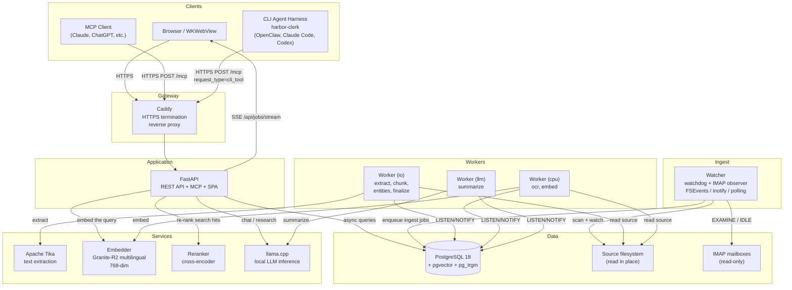
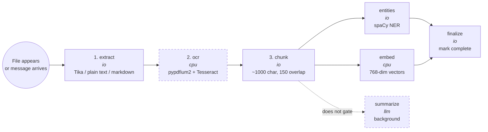
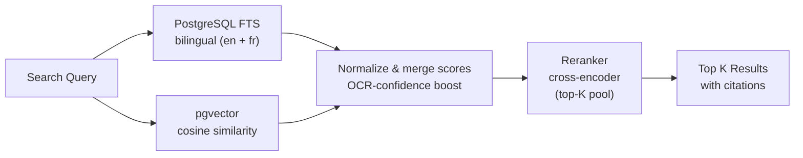
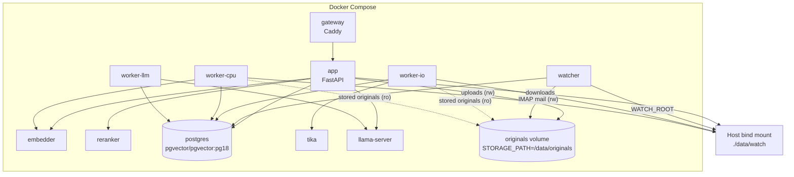
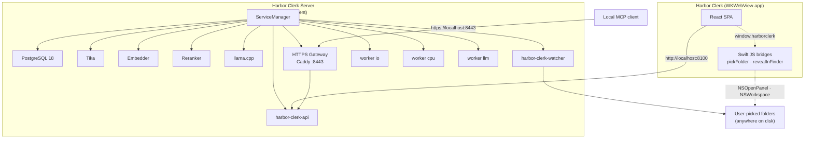
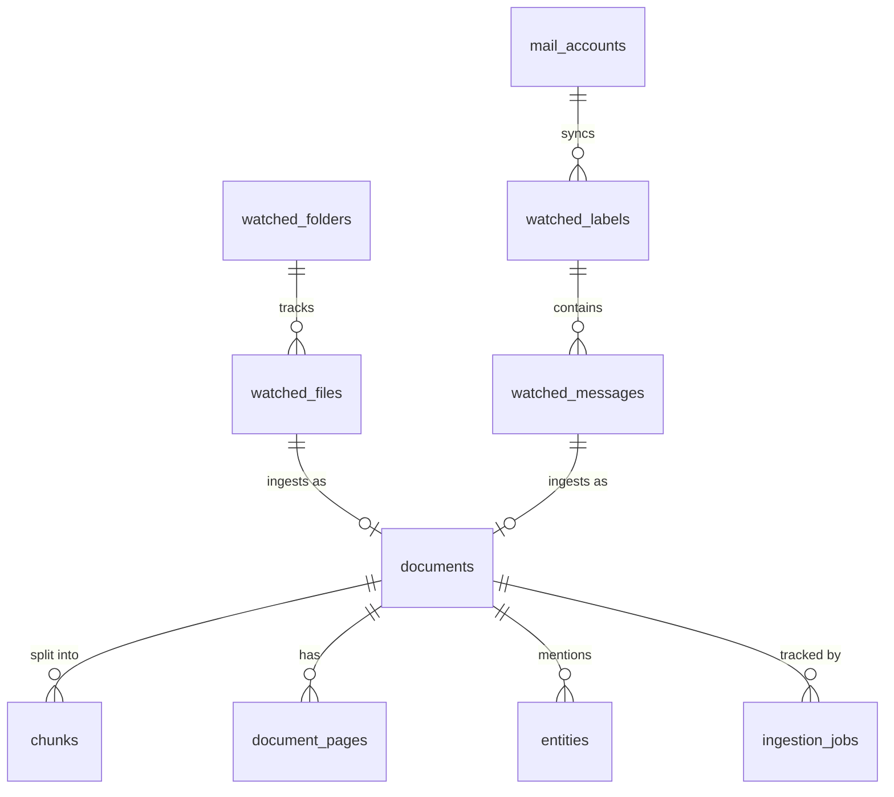
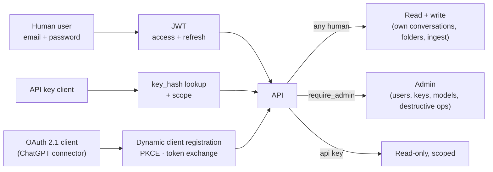

# Harbor Clerk Architecture

The prose and diagrams here describe *why* the system is shaped the way it is.
Every list, table, and count lives under [Generated reference](#generated-reference),
derived from source and verified in CI. **Where the two disagree, the generated
tables are authoritative** — they cannot drift; this prose can.

## System Overview

> The gateway edge above reflects the **Docker Compose** topology. On macOS the
> browser reaches the API directly — see [Deployment Modes](#deployment-modes).
>
> OCR runs **inside** the cpu worker (pypdfium2 rendering + Tesseract). It does
> not call Tika — Tika handles text extraction only.

## Client Surfaces

Three first-class ways for clients to reach the corpus, all reaching the same
backend and the same authorization model. **The transport differs by deployment**
— see the note below the table.

| Surface | Transport | Auth | Audit `request_type` | Primary consumer |
|---|---|---|---|---|
| **Web UI** | Docker: HTTPS via Caddy. macOS: plain HTTP on loopback (`:8100`) | JWT (email + password) | `rest` | Humans in browser / WKWebView |
| **MCP endpoint** | `POST /mcp` (Streamable HTTP) | API key bearer or OAuth 2.1 | `mcp_tool` | Cloud LLMs — Claude, ChatGPT, Claude Desktop, Gemini CLI |
| **`harbor-clerk` CLI** | `POST /mcp` (same endpoint, JSON-RPC framing) | API key bearer | `cli_tool` | Local agent harnesses — OpenClaw, Claude Code, Codex, Aider |

> **Only Docker Compose fronts everything with Caddy.** On macOS the WKWebView
> app loads the SPA directly over plain HTTP on the loopback interface
> (`http://localhost:8100`); the HTTPS gateway there is a *separate* surface on
> `:8443`, used by local MCP clients that require TLS. Authorization, scoping,
> and audit are identical either way — only the transport differs.

The CLI is intentionally a thin shell wrapper over the same MCP transport — it does not get its own API. Two surfaces, one source of truth. Authorization scoping, rate limits, and per-key audit dashboards apply identically. The `request_type` split lets operators separate "human-driven cloud LLM traffic" from "local-agent-driven traffic" in the audit dashboard without giving them different security postures.

The CLI is opt-in (off by default). On macOS the toggle lives in **Harbor Clerk Server → Preferences**; on Docker it's `ENABLE_CLI_ACCESS=true`. See [the CLI agent skill](../skills/harbor-clerk/SKILL.md) for the harness-side surface.

## Ingestion Sources

Two user-facing ingest paths, not one:

- **Watched folders** — files are referenced in place and never altered, copied,
  or moved. A 30-day reaper purges documents whose source stays missing.
- **IMAP mailboxes** — messages and attachments are necessarily *fetched and
  stored* as Documents, because there is no file on disk to reference. The
  mailbox itself is strictly read-only (`EXAMINE`, never marking read or
  deleting), and OAuth scopes must be read-only when OAuth lands.

The legacy `POST /api/uploads/*` endpoints remain callable for non-interactive
sources but have no UI affordance.

Stored content (IMAP messages and attachments, legacy uploads) goes through the
`StorageBackend` (`storage.py`). Both deployments use the filesystem backend,
which keeps each object at `STORAGE_PATH/<bucket>/<key>`: under the app-support
directory on macOS, and on the `originals` named volume under Docker Compose,
mounted read-write by `app` and `watcher` and read-only by the extract and OCR
workers. The MinIO backend remains for an install that still runs MinIO from the
opt-in `minio` Compose profile ([moving off it](upgrade-runbook.md#docker-minio-to-filesystem-storage)).

## Ingestion Pipeline

Seven idempotent stages, each guarded by a row-level lock on `(doc_id, stage)`
via `SELECT ... FOR UPDATE SKIP LOCKED`. Stage assignment and timeouts are in
[the generated table](#ingestion-pipeline-stages).

> **OCR** (dashed) is conditional: always for images; for PDFs only when
> extracted text is sparse; never for text-native formats.
>
> **`summarize`** (dashed) runs on its own `llm` queue and is a *background*
> stage — it does **not** gate `finalize`. A document is searchable as soon as
> `entities` and `embed` complete; its summary may arrive later, or fall back to
> an extractive summary when no LLM is reachable. Any deployment must run a
> worker subscribed to the `llm` queue or summaries silently never appear.

## Retrieval Flow

> Reranker pass is optional (`reranker_enabled`, default on). When disabled or unreachable, the merged FTS+vector score is the final ordering.

## Deployment Modes

Service inventories are generated: [Docker Compose services](#docker-compose-services).

### Docker Compose (Linux / DIY)

#### Local model under Docker Compose

Compose has no launcher to start llama-server per model, so the model is chosen in `.env` and the app follows it (#654).
Setup: [README](../README.md#local-ai-on-docker).

- **Gating.** Every Compose behaviour is gated on `config.is_compose()`: `HC_DEPLOYMENT=compose`, which only
  docker-compose.yml sets (on `app` and `worker-llm`, so a `.env` copied for Docker cannot turn a source run into
  Compose), and no native config.json (the macOS app never is Compose).
- **The served model.** `llama-server` runs one model, `-m /models/$LLM_MODEL_FILE`, at `-c $LLM_CONTEXT_TOKENS`.
  Without `-m` this llama.cpp is a router that refuses every request the app sends, so the entrypoint
  (`docker/llama-server-entrypoint.sh`) refuses a command with no model, waits for a whole GGUF (the container is
  healthy only once a model is loaded), and traps SIGTERM while it waits. It also puts the value of `-c` or
  `--ctx-size` (spaced or `=`) through the context rule below, since llama-server's `std::stoi` would read `8k` as
  8 and `0x0` as 0, crash on `-1` or anything above INT_MAX, and take 0 as the model's full training context.
- **The active model.** `llm_model_id` is the curated id of `LLM_MODEL_FILE` while that file is in the
  `llama_models` volume, and empty otherwise (`config._apply_model_file`, on every `refresh_llm_settings()`).
  Only a leading `./` is dropped from the value; any other path component (`sub/name`, `nosuch/../name`,
  `name/.`) makes it no curated file name.
  Switching away from the served model, or deleting it, is refused with a 409 naming the `.env` change; activating the
  served model, or deactivating when nothing is active, is a no-op.
- **The context.** `effective_context` is `min(window without YaRN, LLM_CONTEXT_TOKENS)`. One rule decides
  `LLM_CONTEXT_TOKENS`, applied identically by the app (`config.parse_context_tokens`) and the entrypoint
  (`context_problem`), so the context prompts are budgeted to and the one llama-server runs at cannot disagree:
  trim ASCII whitespace, then a valid value is 1 to 7 ASCII digits whose value is at least 1 (at most 9,999,999).
  Anything else, zero and empty included, is logged naming the value and runs as the compose default (8192).
  `tests/test_context_tokens_rule.py` runs one table through both sides.
- **Waiting for the server.** Summaries wait for llama-server within one budget of 90 s of *waiting* per document
  (`health.document_wait_budget`, charged only inside `wait_for_server`, never with inference or idle yields), shared
  by the summary and the doc type, with no memory across documents: in a crash loop each document waits its own 90 s.

### macOS Native

> The SPA talks to the API directly over plain HTTP on the loopback interface
> (`api_port`, default **8100**). The HTTPS gateway is a *separate* surface at
> **8443** for local MCP clients that require TLS, with `internal` or
> operator-supplied certificates and a loopback-versus-LAN exposure check.
>
> PostgreSQL and Tika are optionally managed by **launchd** rather than as
> direct subprocesses, so they survive a menubar crash.

## Data Model

The document model is flat: each `documents` row tracks one source file or
message, including its current ingestion status, summary, and OCR/extraction
metadata. Previous versions are not retained in a separate table — reprocessing
updates the row in place.

The full schema, grouped by subsystem with key columns, is generated:
[Database tables](#database-tables). Core relationships:

> `chunks.embedding` is `vector(768)` (Granite-R2), with `fts_en` and `fts_fr`
> generated `tsvector` columns alongside it. `schema_metadata` records the
> embedding model and dimension; the app refuses to start against a mismatch.

## Auth Model

The read/write axis is **human versus API key**, not admin versus user. Any
authenticated human — regardless of role — can create watched folders, ingest,
and chat; `require_human_user` exists specifically to reject API keys on
mutating endpoints. `require_admin` gates a genuinely narrower set: user and
key management, model management, and destructive document operations.

Per-operation gates are generated in the [REST API](#rest-api) table's Access
column, derived from each route's dependency tree.

- **API keys** are read-only, stored as hashes, and carry a scope, rate limits,
  snippet caps, and an expiry. A key's permission tier governs REST as it
  governs MCP: each REST route a key may reach maps to an MCP tool
  (`REST_ROUTE_TOOLS` in `api/scope.py`) and the key must hold that tool;
  every other route is human-only; and no response to a key carries an
  absolute on-disk path (`redact_paths_for_principal`).
- **OAuth 2.1** with dynamic client registration is implemented for connector
  clients: PKCE, authorization codes, token issue/refresh/revoke, and
  `.well-known` discovery documents.
- **Secret storage** — sensitive values (mail-account app passwords, future
  OAuth tokens) are encrypted in Postgres with a per-deployment master key.
  `HARBOR_CLERK_MASTER_KEY` is a hard startup requirement for every service.
  See [secrets-and-keys.md](secrets-and-keys.md).

## Other Subsystems

These ship and are exercised in production, but are not yet described in depth
here. Pointers rather than prose, deliberately — an inaccurate architecture
section is worse than an honest signpost.

| Subsystem | Entry points |
|---|---|
| **Research** — plan → search → read → synthesize, with a cited report and optional citation verifier | `llm/research.py`, `llm/research_prompts.py`, `api/routes/research.py`, `research_state` table |
| **Chat / local LLM orchestration** — tool-calling loop over the retrieval tools, citation assembly, model download and health | `llm/chat.py`, `llm/tools.py`, `llm/citations.py`, `llm/models.py`, `llm/download.py` |
| **Secrets and encryption** — envelope cipher, key sources, master-key management | `secrets/cipher.py`, `secrets/keysource.py` |
| **Topic modelling** — BERTopic clustering surfaced in Observatory | `topics.py`, `corpus_topics` tables |
| **Language packs** — on-demand OCR and NER model downloads | `lang_packs/`, `languages.py`, `api/routes/languages.py` |
| **Metadata extractors** — sidecar and frontmatter parsing into `documents.metadata` JSONB. A sidecar is `<stem>.json` beside a watched document: the extract stage attaches it as `metadata.sidecar.*`; the watcher does not index the file as a document and re-queues the document's extraction when the sidecar is created or changed, which takes the document out of search until its pipeline finishes, as editing the document does, and drops `metadata.sidecar.*` from the document in place when the sidecar is deleted. A `.json` with no such sibling, or one the extractor would decline (over 64 KB, malformed, not an object, empty), is an ordinary document | `ingest/metadata_extractors/`, `watcher/events.py` |
| **Markdown extraction** — a non-Tika path preserving heading structure | `worker/markdown_extract.py`, `worker/heading_parser.py` |

## Generated reference

The tables below are generated from source by `scripts/gen_docs` and verified in
CI. They cannot drift; the prose and diagrams above are hand-maintained and can.

### Ingestion pipeline stages

<!-- BEGIN GENERATED: pipeline-stages -->
<!-- Do not edit by hand. Regenerate: uv run python -m scripts.gen_docs -->

**7 stages across 3 queues** (`cpu`, `io`, `llm`).

| Stage | Queue | Timeout | Role |
|---|---|---|---|
| `extract` | `io` | 600s | sequential (1 of 3) |
| `ocr` | `cpu` | 7200s | sequential (2 of 3) |
| `chunk` | `io` | 1200s | sequential (3 of 3) |
| `entities` | `io` | 900s | parallel — gates `finalize` |
| `embed` | `cpu` | 3600s | parallel — gates `finalize` |
| `summarize` | `llm` | 900s | background — does **not** gate `finalize` |
| `finalize` | `io` | 600s | fan-in |

Queue subscriptions:

- `cpu` — `ocr`, `embed`
- `io` — `extract`, `chunk`, `entities`, `finalize`
- `llm` — `summarize`
<!-- END GENERATED: pipeline-stages -->

### Docker Compose services

<!-- BEGIN GENERATED: compose-services -->
<!-- Do not edit by hand. Regenerate: uv run python -m scripts.gen_docs -->

**11 services** in the default stack, plus 1 behind an opt-in profile (`docker compose --profile <name>`). Generated from `docker-compose.yml`.

| Service | Image | Role | Profile |
|---|---|---|---|
| `app` | built from `docker/app.Dockerfile` | — | default |
| `embedder` | built from `docker/embedder.Dockerfile` | — | default |
| `gateway` | `caddy:2-alpine` | — | default |
| `llama-server` | `ghcr.io/ggml-org/llama.cpp:server-v0.4.1` | — | default |
| `minio` | `${MINIO_IMAGE:-}` | `server` | `minio` |
| `postgres` | `pgvector/pgvector:pg18` | — | default |
| `reranker` | built from `docker/reranker.Dockerfile` | — | default |
| `tika` | `apache/tika:latest` | — | default |
| `watcher` | built from `docker/app.Dockerfile` | `harbor-clerk-watcher` | default |
| `worker-cpu` | built from `docker/app.Dockerfile` | worker — queues: `cpu` | default |
| `worker-io` | built from `docker/app.Dockerfile` | worker — queues: `io` | default |
| `worker-llm` | built from `docker/app.Dockerfile` | worker — queues: `llm` | default |
<!-- END GENERATED: compose-services -->

### Database tables

<!-- BEGIN GENERATED: db-tables -->
<!-- Do not edit by hand. Regenerate: uv run python -m scripts.gen_docs -->

**29 tables.** Generated from SQLAlchemy metadata.

### Documents & ingestion

| Table | Key columns |
|---|---|
| `chunks` | `chunk_id` (PK), `doc_id` → `documents`, `fts_en` (tsvector), `fts_fr` (tsvector), `embedding` (vector) |
| `document_headings` | `heading_id` (PK), `doc_id` → `documents` |
| `document_links` | `link_id` (PK), `src_doc_id` → `documents`, `target_doc_id` → `documents` |
| `document_pages` | `page_id` (PK), `doc_id` → `documents` |
| `documents` | `doc_id` (PK), `topic_id` → `corpus_topics`, `email_parent_doc_id` → `documents` |
| `entities` | `entity_id` (PK), `chunk_id` → `chunks`, `doc_id` → `documents` |
| `ingestion_jobs` | `job_id` (PK), `doc_id` → `documents` |

### Watched folders

| Table | Key columns |
|---|---|
| `watched_files` | `file_id` (PK), `folder_id` → `watched_folders`, `doc_id` → `documents` |
| `watched_folders` | `folder_id` (PK) |

### Email (IMAP)

| Table | Key columns |
|---|---|
| `imap_command_log` | `log_id` (PK), `account_id` → `mail_accounts` |
| `mail_accounts` | `account_id` (PK) |
| `watched_labels` | `label_id` (PK), `account_id` → `mail_accounts` |
| `watched_messages` | `message_pk` (PK), `label_id` → `watched_labels`, `email_doc_id` → `documents` |

### Chat & research

| Table | Key columns |
|---|---|
| `chat_messages` | `message_id` (PK), `conversation_id` → `conversations` |
| `conversations` | `conversation_id` (PK), `user_id` → `users` |
| `research_state` | `conversation_id` (PK) |

### Users & auth

| Table | Key columns |
|---|---|
| `api_keys` | `key_id` (PK) |
| `oauth_clients` | `client_id` (PK) |
| `oauth_codes` | `code_id` (PK), `client_id` → `oauth_clients`, `user_id` → `users` |
| `oauth_tokens` | `token_id` (PK), `client_id` → `oauth_clients`, `user_id` → `users` |
| `users` | `user_id` (PK) |

### Corpus analysis

| Table | Key columns |
|---|---|
| `corpus_topics` | `topic_id` (PK) |
| `corpus_topics_meta` | `id` (PK) |

### Operations & audit

| Table | Key columns |
|---|---|
| `api_request_log` | `request_id` (PK), `api_key_id` → `api_keys` |
| `audit_log` | `audit_id` (PK), `user_id` → `users`, `api_key_id` → `api_keys` |
| `model_settings` | `model_id` (PK) |
| `schema_metadata` | `key` (PK) |

### Legacy uploads

| Table | Key columns |
|---|---|
| `upload_sessions` | `session_id` (PK), `user_id` → `users` |
| `uploads` | `upload_id` (PK), `user_id` → `users`, `doc_id` → `documents`, `session_id` → `upload_sessions` |
<!-- END GENERATED: db-tables -->

### REST API

<!-- BEGIN GENERATED: rest-endpoints -->
<!-- Do not edit by hand. Regenerate: uv run python -m scripts.gen_docs -->

**142 operations**, 125 of them access-gated. Generated from the FastAPI OpenAPI schema; the Access column is derived from each route's dependency tree. **admin** needs an admin session; **human only** rejects API keys; **key ≥ tier (tool)** admits an API key whose tier, or a per-key tool override, grants the named MCP tool — the one that governs the route, per `REST_ROUTE_TOOLS` in `api/scope.py`. Keys never receive absolute on-disk paths at any tier.

### `api-keys`

| Method | Path | Access | Summary |
|---|---|---|---|
| `GET` | `/api/api-keys` | **admin** | List Api Keys |
| `POST` | `/api/api-keys` | **admin** | Create Api Key |
| `POST` | `/api/api-keys/scope-preview` | **admin** | Scope Preview Adhoc |
| `DELETE` | `/api/api-keys/{key_id}` | **admin** | Delete Api Key |
| `PATCH` | `/api/api-keys/{key_id}` | **admin** | Patch Api Key |
| `GET` | `/api/api-keys/{key_id}/scope-preview` | **admin** | Scope Preview |
| `DELETE` | `/api/api-keys/{key_id}/usage` | **admin** | Purge Key Usage |
| `GET` | `/api/api-keys/{key_id}/usage` | **admin** | Get Key Usage |
| `GET` | `/api/api-keys/{key_id}/usage/requests` | **admin** | Get Key Requests |
| `GET` | `/api/api-keys/{key_id}/usage/timeline` | **admin** | Get Key Timeline |

### `auth`

| Method | Path | Access | Summary |
|---|---|---|---|
| `POST` | `/api/auth/login` | — | Login |
| `POST` | `/api/auth/logout` | — | Logout |
| `POST` | `/api/auth/refresh` | — | Refresh |
| `GET` | `/api/me` | — | Get Me |
| `POST` | `/api/me/password` | — | Change Password |
| `PATCH` | `/api/me/preferences` | — | Update Preferences |

### `chat`

| Method | Path | Access | Summary |
|---|---|---|---|
| `GET` | `/api/chat/conversations` | **human only** | List Conversations |
| `POST` | `/api/chat/conversations` | **human only** | Create Conversation |
| `DELETE` | `/api/chat/conversations/{conv_id}` | **human only** | Delete Conversation |
| `GET` | `/api/chat/conversations/{conv_id}` | **human only** | Get Conversation |
| `GET` | `/api/chat/conversations/{conv_id}/export` | **human only** | Export Conversation |
| `POST` | `/api/chat/conversations/{conv_id}/messages` | **human only** | Send Message |
| `GET` | `/api/chat/models` | **human only** | List Available Models |
| `PUT` | `/api/chat/models/deactivate` | **admin** | Deactivate Model |
| `GET` | `/api/chat/models/download-progress` | **human only** | Download Progress Stream |
| `GET` | `/api/chat/models/orphaned` | **human only** | List Orphaned Models |
| `DELETE` | `/api/chat/models/orphaned/{filename}` | **admin** | Remove Orphaned Model |
| `GET` | `/api/chat/models/status` | **human only** | Llm Status |
| `GET` | `/api/chat/models/summary-afm` | **human only** | Get Summary Force Afm |
| `PUT` | `/api/chat/models/summary-afm` | **admin** | Toggle Summary Force Afm |
| `GET` | `/api/chat/models/yarn` | **human only** | Get Yarn Status |
| `PUT` | `/api/chat/models/yarn` | **admin** | Toggle Yarn |
| `DELETE` | `/api/chat/models/{model_id}` | **admin** | Remove Model |
| `PUT` | `/api/chat/models/{model_id}/activate` | **admin** | Activate Model |
| `POST` | `/api/chat/models/{model_id}/download` | **admin** | Start Model Download |

### `documents`

| Method | Path | Access | Summary |
|---|---|---|---|
| `GET` | `/api/docs` | **key ≥ search (kb_list_recent)** | List Documents |
| `GET` | `/api/docs/entities/autocomplete` | **key ≥ full (kb_entity_search)** | Entity Autocomplete |
| `GET` | `/api/docs/entities/top` | **key ≥ full (kb_entity_overview)** | Top Entities |
| `GET` | `/api/docs/filters` | **key ≥ search (kb_corpus_overview)** | Document Filters |
| `GET` | `/api/docs/overview` | **key ≥ search (kb_corpus_overview)** | Corpus Overview |
| `POST` | `/api/docs/reprocess-failed` | **admin** | Reprocess Failed Documents |
| `DELETE` | `/api/docs/{doc_id}` | **admin** | Delete Document |
| `GET` | `/api/docs/{doc_id}` | **key ≥ read (kb_get_document)** | Get Document |
| `POST` | `/api/docs/{doc_id}/cancel` | **admin** | Cancel Processing |
| `GET` | `/api/docs/{doc_id}/content` | **key ≥ full (kb_read_document)** | Get Document Content |
| `GET` | `/api/docs/{doc_id}/download` | **key ≥ full (kb_read_document)** | Download Document |
| `GET` | `/api/docs/{doc_id}/entities` | **key ≥ full (kb_entity_overview)** | Get Document Entities |
| `GET` | `/api/docs/{doc_id}/outline` | **key ≥ read (kb_document_outline)** | Get Document Outline |
| `GET` | `/api/docs/{doc_id}/related` | **key ≥ full (kb_find_related)** | Find Related Documents |
| `POST` | `/api/docs/{doc_id}/reprocess` | **admin** | Reprocess Document |
| `POST` | `/api/docs/{doc_id}/resummarize` | **admin** | Resummarize Document |

### `jobs`

| Method | Path | Access | Summary |
|---|---|---|---|
| `GET` | `/api/jobs/active` | **human only** | Active Jobs |
| `GET` | `/api/jobs/snapshot` | **human only** | Jobs Snapshot |
| `GET` | `/api/jobs/stream` | **human only** | Job Stream |

### `languages`

| Method | Path | Access | Summary |
|---|---|---|---|
| `GET` | `/api/languages` | **human only** | List Languages |
| `DELETE` | `/api/languages/{lang_code}` | **admin** | Remove Language Completely |
| `POST` | `/api/languages/{lang_code}/install` | **admin** | Install Language Tools |
| `DELETE` | `/api/languages/{lang_code}/install/{tool_name}` | **admin** | Remove Language Tool |

### `mail`

| Method | Path | Access | Summary |
|---|---|---|---|
| `GET` | `/api/mail/accounts` | **admin** | List Mail Accounts |
| `POST` | `/api/mail/accounts` | **admin** | Create Mail Account |
| `DELETE` | `/api/mail/accounts/{account_id}` | **admin** | Delete Mail Account |
| `POST` | `/api/mail/accounts/{account_id}/test` | **admin** | Test Mail Account |
| `GET` | `/api/mail/labels` | **admin** | List Watched Labels |
| `POST` | `/api/mail/labels` | **admin** | Create Watched Label |
| `DELETE` | `/api/mail/labels/{label_id}` | **admin** | Delete Watched Label |
| `POST` | `/api/mail/labels/{label_id}/rescan` | **admin** | Rescan Label |

### `oauth`

| Method | Path | Access | Summary |
|---|---|---|---|
| `GET` | `/.well-known/oauth-authorization-server` | — | Oauth Authorization Server |
| `GET` | `/.well-known/oauth-protected-resource` | — | Oauth Protected Resource |
| `GET` | `/api/integrations/connections` | **admin** | List Connections |
| `DELETE` | `/api/integrations/connections/{client_id}` | **admin** | Delete Connection |
| `GET` | `/api/integrations/settings` | **admin** | Get Integration Settings |
| `PUT` | `/api/integrations/settings` | **admin** | Update Integration Settings |
| `GET` | `/oauth/authorize` | — | Oauth Authorize Get |
| `POST` | `/oauth/authorize` | — | Oauth Authorize Post |
| `POST` | `/oauth/register` | — | Oauth Register |
| `POST` | `/oauth/revoke` | — | Oauth Revoke |
| `POST` | `/oauth/token` | — | Oauth Token |

### `research`

| Method | Path | Access | Summary |
|---|---|---|---|
| `GET` | `/api/research` | **human only** | List Research |
| `POST` | `/api/research` | **human only** | Start Research |
| `GET` | `/api/research/active` | **human only** | Check Active |
| `DELETE` | `/api/research/{conv_id}` | **human only** | Delete Research |
| `GET` | `/api/research/{conv_id}` | **human only** | Get Research |
| `POST` | `/api/research/{conv_id}/resume` | **human only** | Resume Research |

### `search`

| Method | Path | Access | Summary |
|---|---|---|---|
| `POST` | `/api/passages/read` | **key ≥ read (kb_read_passages)** | Read Passages |
| `POST` | `/api/search` | **key ≥ search (kb_search)** | Search |
| `POST` | `/api/search/find-all` | **key ≥ search (kb_find_all)** | Search Find All |

### `setup`

| Method | Path | Access | Summary |
|---|---|---|---|
| `POST` | `/api/setup` | — | Setup |

### `stats`

| Method | Path | Access | Summary |
|---|---|---|---|
| `GET` | `/api/docs/{doc_id}/stats` | **human only** | Document Stats |
| `GET` | `/api/stats` | **human only** | Corpus Stats |
| `GET` | `/api/stats/clusters` | **human only** | Document Clusters |
| `GET` | `/api/stats/entity-network` | **human only** | Entity Network |
| `GET` | `/api/stats/timeline` | **human only** | Document Timeline |
| `GET` | `/api/stats/topics` | **human only** | Topic Clusters |

### `system`

| Method | Path | Access | Summary |
|---|---|---|---|
| `POST` | `/api/system/clear-queue` | **admin** | Clear Queue |
| `POST` | `/api/system/clear-redundant-summary-backlog` | **admin** | Clear Redundant Summary Backlog |
| `POST` | `/api/system/delete-all-documents` | **admin** | Delete All Documents |
| `GET` | `/api/system/health` | — | Health Check |
| `GET` | `/api/system/logs` | **admin** | List Logs |
| `GET` | `/api/system/ping` | — | Ping |
| `POST` | `/api/system/purge-run` | **admin** | Purge Run |
| `GET` | `/api/system/rate-limit-settings` | **admin** | Get Rate Limit Settings |
| `PUT` | `/api/system/rate-limit-settings` | **admin** | Update Rate Limit Settings |
| `POST` | `/api/system/reaper-run` | **admin** | Reaper Run |
| `POST` | `/api/system/recompute-topics` | **admin** | Recompute Topics Endpoint |
| `POST` | `/api/system/repair-completed-statuses` | **admin** | Repair Completed Statuses |
| `POST` | `/api/system/reprocess-all` | **admin** | Reprocess All |
| `POST` | `/api/system/reprocess-all-skip-summarize` | **admin** | Reprocess All Skip Summarize |
| `POST` | `/api/system/resummarize-all` | **admin** | Resummarize All |
| `GET` | `/api/system/retrieval-settings` | **admin** | Get Retrieval Settings |
| `PUT` | `/api/system/retrieval-settings` | **admin** | Update Retrieval Settings |
| `POST` | `/api/system/run-migrations` | **admin** | Run Migrations |
| `GET` | `/api/system/setup-status` | — | Setup Status |
| `GET` | `/api/system/stats` | **admin** | System Stats |
| `GET` | `/api/system/status-summary` | **admin** | Status Summary |
| `GET` | `/api/system/summary-backlog` | **admin** | Get Summary Backlog |

### `uploads`

| Method | Path | Access | Summary |
|---|---|---|---|
| `GET` | `/api/uploads` | **human only** | List Uploads |
| `POST` | `/api/uploads` | **human only** | Upload Files |
| `POST` | `/api/uploads/confirm` | **human only** | Confirm Upload |
| `POST` | `/api/uploads/confirm-batch` | **human only** | Confirm Upload Batch |
| `POST` | `/api/uploads/sessions` | **human only** | Create Session |
| `DELETE` | `/api/uploads/sessions/{session_id}` | **human only** | Cancel Session |
| `GET` | `/api/uploads/sessions/{session_id}` | **human only** | Get Upload Session |
| `POST` | `/api/uploads/sessions/{session_id}/confirm` | **human only** | Confirm Session |
| `POST` | `/api/uploads/sessions/{session_id}/files` | **human only** | Upload File To Session |
| `GET` | `/api/uploads/sessions/{session_id}/resume` | **human only** | Get Resume Info |

### `users`

| Method | Path | Access | Summary |
|---|---|---|---|
| `GET` | `/api/users` | **admin** | List Users |
| `POST` | `/api/users` | **admin** | Create User |
| `DELETE` | `/api/users/{user_id}` | **admin** | Delete User |
| `GET` | `/api/users/{user_id}` | **admin** | Get User |
| `PATCH` | `/api/users/{user_id}` | **admin** | Update User |

### `watch`

| Method | Path | Access | Summary |
|---|---|---|---|
| `GET` | `/api/watch/allowed-extensions` | **human only** | Allowed Extensions |
| `GET` | `/api/watch/folders` | **human only** | List Folders |
| `POST` | `/api/watch/folders` | **human only** | Create Folder |
| `GET` | `/api/watch/folders/stream` | **human only** | Folder Progress Stream |
| `DELETE` | `/api/watch/folders/{folder_id}` | **human only** | Delete Folder |
| `PATCH` | `/api/watch/folders/{folder_id}` | **human only** | Patch Folder |
| `GET` | `/api/watch/folders/{folder_id}/progress` | **human only** | Get Folder Progress |
| `POST` | `/api/watch/folders/{folder_id}/rescan` | **human only** | Rescan Folder |
| `POST` | `/api/watch/ingest` | **human only** | Ingest File |
| `POST` | `/api/watch/remove` | **human only** | Remove File |
| `POST` | `/api/watch/rename` | **human only** | Rename File |
| `GET` | `/api/watch/system` | **human only** | Get System |
<!-- END GENERATED: rest-endpoints -->

### Console scripts

<!-- BEGIN GENERATED: entry-points -->
<!-- Do not edit by hand. Regenerate: uv run python -m scripts.gen_docs -->

**5 console scripts**, declared in `[project.scripts]`.

| Command | Target | Purpose |
|---|---|---|
| `harbor-clerk` | `harbor_clerk.cli.main:main` | CLI for agent harnesses. Off by default, gated by `ENABLE_CLI_ACCESS`. |
| `harbor-clerk-api` | `harbor_clerk.api.app:main` | FastAPI server — REST API, MCP endpoint, and the built SPA. |
| `harbor-clerk-seed` | `harbor_clerk.seed:main` | Database seeder. |
| `harbor-clerk-watcher` | `harbor_clerk.watcher.main:main` | Watched-folder and IMAP observer; enqueues ingest jobs. One per deployment. |
| `harbor-clerk-worker` | `harbor_clerk.worker.entry:main` | Ingestion worker. Subscribes to one or more queues via `--queues`. |
<!-- END GENERATED: entry-points -->

### CLI subcommands

<!-- BEGIN GENERATED: cli-commands -->
<!-- Do not edit by hand. Regenerate: uv run python -m scripts.gen_docs -->

**19 subcommands**, mirroring the MCP tool surface. Enable with `ENABLE_CLI_ACCESS=true` (Docker) or the macOS Preferences toggle.

| Command | Description |
|---|---|
| `harbor-clerk batch-search` | harbor-clerk batch-search — run multiple searches in one call |
| `harbor-clerk corpus-overview` | harbor-clerk corpus-overview — corpus-level statistics and document list |
| `harbor-clerk document-outline` | harbor-clerk document-outline — heading tree, page count, and chunk count |
| `harbor-clerk documents-by-date` | harbor-clerk documents-by-date — date-sorted document lookup |
| `harbor-clerk entity-cooccurrence` | harbor-clerk entity-cooccurrence — entities that appear alongside a given entity |
| `harbor-clerk entity-overview` | harbor-clerk entity-overview — aggregate entity statistics (corpus or per-doc) |
| `harbor-clerk entity-search` | harbor-clerk entity-search — search named entities by name or type |
| `harbor-clerk expand-context` | harbor-clerk expand-context — read N chunks before and after a target chunk |
| `harbor-clerk find-all` | harbor-clerk find-all - enumerate matching documents |
| `harbor-clerk find-related` | harbor-clerk find-related — find documents similar to a given document |
| `harbor-clerk get-document` | harbor-clerk get-document — document metadata, status, and pipeline jobs |
| `harbor-clerk ingest-status` | harbor-clerk ingest-status — per-stage ingestion progress for one document |
| `harbor-clerk list-recent` | harbor-clerk list-recent — recently updated documents |
| `harbor-clerk read-document` | harbor-clerk read-document — read a document's text by page range |
| `harbor-clerk read-passages` | harbor-clerk read-passages — fetch full passage text by chunk ID |
| `harbor-clerk reprocess` | harbor-clerk reprocess — re-run the full ingestion pipeline for a document |
| `harbor-clerk search` | harbor-clerk search — hybrid FTS + vector search |
| `harbor-clerk system-health` | harbor-clerk system-health — daemon + storage health snapshot |
| `harbor-clerk verify-identifier` | harbor-clerk verify-identifier — verify an identifier resolves to one document |
<!-- END GENERATED: cli-commands -->
